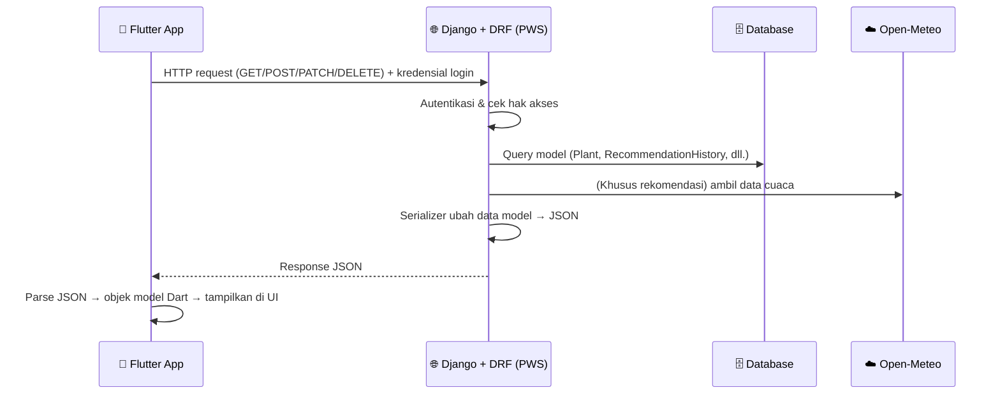

<div align="center">

# 🌱 NANEM Mobile

**Rekomendasi tanaman berdasarkan kondisi cuaca & media tanam kamu, sekarang dalam genggaman.**


📱 [**Download APK**](#-tautan-penting) &nbsp;|&nbsp; 🌐 [**Web NANEM (PWS)**](https://jihan-nabiilah-nanem.pws.cs.ui.ac.id/) &nbsp;|&nbsp; 🎨 [**Desain Figma**](https://www.figma.com/design/cHfPMtY5z1b3hZdhOH6qLj/Untitled?t=8elytltRLo4KhqEf-1)

</div>

---

## 📑 Daftar Isi

- [👥 Anggota Tim](#-anggota-tim)
- [📖 Deskripsi Aplikasi](#-deskripsi-aplikasi)
- [🧩 Daftar Modul & Pembagian Kerja](#-daftar-modul--pembagian-kerja)
- [🔐 Peran Pengguna](#-peran-pengguna)
- [🔄 Alur Integrasi Data Mobile ↔ Web](#-alur-integrasi-data-mobile--web)
- [🎨 Desain Figma](#-desain-figma)
- [🚀 Deployment](#-deployment)
- [⚙️ Menjalankan Secara Lokal](#️-menjalankan-secara-lokal)
- [🤖 Penggunaan AI](#-penggunaan-ai)
- [🔗 Tautan Penting](#-tautan-penting)

---

## 👥 Anggota Tim

| No  | Nama                          | NPM        |
| :-: | ----------------------------- | ---------- |
|  1  | Jihan Nabiilah Permata Sukma  | 2506549026 |
|  2  | Muhammad Hafidz Muazzam       | 2506621812 |
|  3  | Zhafira Richas                | 2506540941 |
|  4  | Muhammad Eshan Bobby Bhaskara | 2506546333 |
|  5  | Johannes Nichola Simatupang   | 2406495930 |

---

## 📖 Deskripsi Aplikasi

**NANEM** adalah aplikasi yang memberikan **rekomendasi tanaman berdasarkan kondisi cuaca di lokasi pengguna**, dengan mempertimbangkan media tanam yang dipakai (tanah atau hidroponik). Pengguna jadi tahu tanaman apa yang cocok ditanam tanpa harus menebak-nebak.

**NANEM Mobile** adalah versi aplikasi Android dari [situs web NANEM](https://jihan-nabiilah-nanem.pws.cs.ui.ac.id/) yang dikembangkan pada Proyek Tengah Semester. Aplikasi ini dibangun dengan **Flutter** dan memakai **data serta logika yang sama** dengan versi web melalui web service **Django REST Framework**, sehingga akun, riwayat, dan koleksi pengguna tersinkron di kedua platform.

### 🎯 Target pengguna

- 🌿 Masyarakat yang ingin mulai bercocok tanam
- 🏡 Pemilik lahan skala kecil
- 🔰 Pemula yang belum tahu tanaman apa yang cocok dengan kondisi lingkungannya
- 🏙️ Pengguna urban farming dengan media tanam terbatas, termasuk hidroponik

### 💡 Cara kerja

Pengguna memasukkan:

| Input              | Wajib? | Keterangan                                                                          |
| ------------------ | ------ | ----------------------------------------------------------------------------------- |
| 📍 **Lokasi**      | Ya     | Latitude (−90 s.d. 90) & longitude (−180 s.d. 180), bisa diambil dari GPS perangkat |
| 🏷️ **Nama lahan**  | Ya     | Nama untuk mengenali lahan di riwayat, maksimal 100 karakter                        |
| 📐 **Luas lahan**  | Ya     | Luas area tanam dalam m², minimal 0,01                                              |
| 🪴 **Media tanam** | Ya     | Tanah atau hidroponik                                                               |

Kemudian server NANEM akan:

1. Mengambil data **suhu, kelembapan, dan curah hujan** rata-rata ±90 hari terakhir dari koordinat tersebut lewat **Open-Meteo API**.
2. Mencocokkan data cuaca, media tanam, dan luas lahan dengan katalog tanaman menggunakan **rule-based recommendation engine**.
3. Mengirim **10 tanaman teratas** beserta **tingkat kecocokan** dan alasannya ke aplikasi untuk ditampilkan.

> Proses rekomendasi tetap berjalan di server Django. Aplikasi Flutter hanya mengirim input dan menampilkan hasil, sehingga hasil rekomendasi di web dan mobile selalu konsisten.

---

## 🧩 Daftar Modul & Pembagian Kerja

Setiap anggota bertanggung jawab atas modul yang sama seperti di Proyek Tengah Semester, mencakup **halaman Flutter** dan **endpoint Django REST Framework** untuk modulnya.

|  #  | Modul                                 | PIC          |
| :-: | ------------------------------------- | ------------ |
|  1  | 🔐 Autentikasi, Rekomendasi & Riwayat | **Jihan**    |
|  2  | 👤 Profil Pengguna                    | **Hafidz**   |
|  3  | 📔 Koleksi Tanaman                    | **Zhafira**  |
|  4  | 📚 Katalog Tanaman                    | **Bobby**    |
|  5  | 🧑‍🌾 Panduan Budidaya                   | **Nicholas** |

### 1️⃣ Autentikasi, Rekomendasi & Riwayat — _Jihan_

- Halaman register, login, dan logout yang terhubung ke akun Django.
- Form rekomendasi (lokasi, nama lahan, luas lahan, media tanam) dan halaman hasil berisi daftar tanaman + skor kecocokan.
- Simpan hasil rekomendasi ke riwayat (khusus pengguna yang login).
- Riwayat rekomendasi: lihat daftar dan detail, cari berdasarkan nama lahan, ubah nama lahan, hapus riwayat.

### 2️⃣ Profil Pengguna — _Hafidz_

- Melihat profil sendiri dan profil pengguna lain, beserta koleksi tanamannya.
- Mencari pengguna lain berdasarkan username.
- Mengubah nama, username, foto profil, dan kata sandi.
- Menghapus akun.

### 3️⃣ Koleksi Tanaman — _Zhafira_

- Feed koleksi tanaman dari semua pengguna, dengan fitur suka (like).
- Membuat postingan koleksi (foto dari kamera/galeri, judul, deskripsi).
- Mengubah dan menghapus postingan milik sendiri.

### 4️⃣ Katalog Tanaman — _Bobby_

- Melihat, mencari, dan memfilter katalog tanaman.
- Admin: menambah, mengubah, dan menghapus data tanaman.

### 5️⃣ Panduan Budidaya — _Nicholas_

- Melihat panduan budidaya tiap tanaman (cara menanam, penyiraman, cahaya, pemupukan, waktu panen).
- Admin: menambah, mengubah, dan menghapus panduan.

> 📝 Katalog Tanaman dan Panduan Budidaya tetap dua modul terpisah, meskipun di aplikasi keduanya tampil dalam satu halaman _Plant Detail_.

---

## 🔐 Peran Pengguna

| Fitur                                |      👻 Guest       |      👤 User       | 🛡️ Admin |
| ------------------------------------ | :-----------------: | :----------------: | :------: |
| Rekomendasi Tanaman                  | ✅ (tidak disimpan) | ✅ (bisa disimpan) |    ✅    |
| Lihat, cari & filter Katalog Tanaman |         ❌          |         ✅         |    ✅    |
| Detail Tanaman + Panduan Budidaya    |         ❌          |         ✅         |    ✅    |
| CRUD Riwayat Rekomendasi\*           |         ❌          |         ✅         |    ✅    |
| CRUD Profil Pengguna                 |         ❌          |         ✅         |    ✅    |
| CRUD Koleksi Tanaman                 |         ❌          |         ✅         |    ✅    |
| CRUD Katalog Tanaman                 |         ❌          |         ❌         |    ✅    |
| CRUD Panduan Budidaya                |         ❌          |         ❌         |    ✅    |

\* Hasil rekomendasi tidak dapat diubah manual, hanya nama lahan.

- **👻 Guest:** pengguna yang belum login. Bisa mencoba rekomendasi, tetapi hasilnya tidak disimpan.
- **👤 User:** pengguna terdaftar. Bisa menyimpan riwayat, mengelola profil dan koleksi, serta menjelajahi katalog dan panduan.
- **🛡️ Admin:** akun Django dengan `is_staff=True`. Mengelola data master katalog tanaman dan panduan budidaya.

---

## 🔄 Alur Integrasi Data Mobile ↔ Web

> 🚧 Bagian ini adalah **rancangan integrasi**. Nama endpoint dan detail teknis akan disesuaikan saat implementasi.

Aplikasi Flutter **tidak memiliki database sendiri**. Semua data diambil dan disimpan ke **database yang sama dengan situs web NANEM di PWS**. Penghubungnya adalah web service yang ditambahkan ke proyek Django menggunakan **Django REST Framework (DRF)**.



### Langkah integrasi

1. **Sisi Django (proyek PTS)**
   - Menambahkan `djangorestframework` ke proyek web NANEM.
   - Membuat **serializer** untuk tiap model (`Plant`, `CultivationGuide`, `PlantCollection`, `RecommendationHistory`, `UserProfile`) yang mengubah data model menjadi JSON dan memvalidasi data masuk.
   - Membuat **API view / ViewSet** beserta URL di bawah prefix `/api/`, dengan permission yang sesuai peran (guest, user, admin).
   - Logika rekomendasi yang sudah ada (Open-Meteo + rule-based engine) **dipakai ulang**, bukan ditulis ulang di Flutter.
   - Mengatur konfigurasi agar aplikasi mobile dapat mengakses API di domain PWS.

2. **Sisi Flutter**
   - Membuat **model Dart** untuk tiap entitas, lengkap dengan `fromJson` dan `toJson`.
   - Mengirim request ke API PWS menggunakan package HTTP, lalu menyimpan sesi login agar request berikutnya teridentifikasi sebagai user yang sama.
   - Menampilkan data hasil parsing di widget (misalnya `FutureBuilder`/`ListView`) dan mengirim data form kembali ke server.
   - Unggah foto (profil dan koleksi) dikirim sebagai `multipart/form-data`.

3. **Autentikasi**
   - Login di aplikasi memakai akun Django yang sama dengan web, sehingga satu akun berlaku di dua platform.
   - Mekanisme sesi (session cookie atau token DRF) akan ditentukan saat implementasi.

### Rancangan endpoint

| Modul            | Endpoint                      | Method                               | Keterangan                                                                |
| ---------------- | ----------------------------- | ------------------------------------ | ------------------------------------------------------------------------- |
| Autentikasi      | `/api/auth/register/`         | POST                                 | Registrasi akun baru                                                      |
|                  | `/api/auth/login/`            | POST                                 | Login                                                                     |
|                  | `/api/auth/logout/`           | POST                                 | Logout                                                                    |
|                  | `/api/auth/password/`         | POST                                 | Ganti kata sandi                                                          |
| Rekomendasi      | `/api/recommendations/`       | POST                                 | Generate rekomendasi dari input (guest & user)                            |
| Riwayat          | `/api/history/`               | GET, POST                            | Daftar riwayat user (`?q=` untuk cari); simpan hasil rekomendasi terakhir |
|                  | `/api/history/<id>/`          | GET, PATCH, DELETE                   | Detail, ubah nama lahan, hapus                                            |
| Profil           | `/api/profile/`               | GET, PATCH, DELETE                   | Profil sendiri (ubah nama, username, foto; hapus akun)                    |
|                  | `/api/profile/search/?q=`     | GET                                  | Cari pengguna berdasarkan username                                        |
|                  | `/api/profile/<username>/`    | GET                                  | Profil pengguna lain                                                      |
| Koleksi Tanaman  | `/api/collections/`           | GET, POST                            | Feed koleksi & buat postingan                                             |
|                  | `/api/collections/<id>/`      | GET, PATCH, DELETE (pemilik)         | Detail, ubah, hapus                                                       |
|                  | `/api/collections/<id>/like/` | POST                                 | Suka / batal suka                                                         |
| Katalog Tanaman  | `/api/plants/`                | GET, POST (admin)                    | Daftar, cari, filter & tambah tanaman                                     |
|                  | `/api/plants/<id>/`           | GET, PUT/PATCH, DELETE (admin)       | Detail, ubah, hapus                                                       |
| Panduan Budidaya | `/api/plants/<id>/guide/`     | GET, POST, PUT/PATCH, DELETE (admin) | Panduan budidaya untuk satu tanaman                                       |

> Simpan riwayat (`POST /api/history/`) tidak menerima daftar tanaman dari aplikasi. Server menyimpan hasil rekomendasi terakhir yang ia hitung sendiri, sehingga hasil tidak bisa dimanipulasi dari sisi klien.

---

## 🎨 Desain Figma

🎨 [**Buka desain Figma NANEM**](https://www.figma.com/design/cHfPMtY5z1b3hZdhOH6qLj/Untitled?t=8elytltRLo4KhqEf-1)

---

## 🚀 Deployment

- APK dirilis sebagai **GitHub Release** di repositori ini dan dibangun melalui **Bitrise**.
- Aplikasi menggunakan **logo NANEM** milik kelompok sebagai ikon aplikasi.
- Tautan APK akan ditambahkan setelah Checkpoint 1.

---

## ⚙️ Menjalankan Secara Lokal

> Pastikan [Flutter SDK](https://docs.flutter.dev/get-started/install) sudah terpasang dan `flutter doctor` tidak menunjukkan error.

```bash
# 1. Clone repository
git clone https://github.com/PBP-C13-25/NANEM-mobile
cd NANEM-mobile

# 2. Install dependencies
flutter pub get

# 3. Jalankan aplikasi di emulator atau perangkat
flutter run

# 4. Build APK
flutter build apk --release
```

Secara default aplikasi terhubung ke server PWS. Untuk development dengan server Django lokal, ganti base URL API ke alamat server lokal (misalnya `http://10.0.2.2:8000` untuk emulator Android).

---

## 🤖 Penggunaan AI

Selama pengembangan, tim menggunakan asisten AI (seperti Claude) sebagai teman diskusi dan alat bantu, antara lain untuk diskusi perancangan alur dan integrasi, perbaikan kode berdasarkan code review, penyusunan pesan commit dan komentar review, serta pengujian.

Keputusan akhir mengenai alur dan fitur tetap ditentukan oleh tim. Seluruh kode yang digunakan telah dipahami, disesuaikan, dan diuji sendiri oleh PIC masing-masing modul.

---

## 🔗 Tautan Penting

|                        | Tautan                                                                                          |
| ---------------------- | ----------------------------------------------------------------------------------------------- |
| 📱 **APK (Release)**   | _Menyusul setelah Checkpoint 1_                                                                 |
| 🛠️ **Bitrise**         | _Menyusul_                                                                                      |
| 🌐 **Web NANEM (PWS)** | https://jihan-nabiilah-nanem.pws.cs.ui.ac.id/                                                   |
| 💻 **Repositori Web**  | [Repositori Django PTS](https://github.com/PBP-C13-25/NANEM)                                    |
| 🎨 **Figma**           | [Buka Figma](https://www.figma.com/design/cHfPMtY5z1b3hZdhOH6qLj/Untitled?t=8elytltRLo4KhqEf-1) |

# nanem_mobile

A new Flutter project.

## Getting Started

This project is a starting point for a Flutter application.

A few resources to get you started if this is your first Flutter project:

- [Learn Flutter](https://docs.flutter.dev/get-started/learn-flutter)
- [Write your first Flutter app](https://docs.flutter.dev/get-started/codelab)
- [Flutter learning resources](https://docs.flutter.dev/reference/learning-resources)

For help getting started with Flutter development, view the
[online documentation](https://docs.flutter.dev/), which offers tutorials,
samples, guidance on mobile development, and a full API reference.
